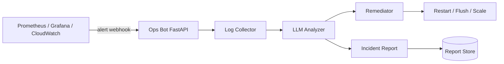

# SovereignGuard — AI-Driven Cloud Resiliency & Automated Incident Remediation

SovereignGuard is an end-to-end platform that monitors service health, uses an LLM to
analyze real-time anomalies and failure logs, executes automated remediation (self-healing),
and generates standardized incident reports.

## Architecture



## Key Operational Features

- **High availability**: multi-AZ VPC, ALB with zero-downtime health checks, auto-scaling compute fleet.
- **Self-healing**: automated remediation actions (restart container/service, flush cache, scale out).
- **Observability**: Prometheus alert rules and Grafana dashboards for latency, CPU, memory, 5xx.
- **GenAI ops assistant**: structured LLM prompts for root-cause analysis and SOP draft generation.
- **Safe by default**: dry-run remediation, webhook secret verification.

## Repository Structure

```
sovereign-guard/
├── .github/workflows/   # CI/CD
├── docs/                # Architecture & runbook
├── infrastructure/      # Terraform IaC
├── observability/       # Prometheus rules & Grafana dashboards
├── src/                 # Python AI engine & remediation service
├── ansible/             # Remediation playbooks
├── tests/               # Unit & integration tests
└── README.md
```

## Getting Started

```bash
python -m venv .venv && source .venv/bin/activate
pip install -r requirements.txt
cp .env.example .env
uvicorn src.main:app --reload
```

Run tests:
```bash
pytest -q
```

Trigger a test alert:
```bash
curl -X POST http://localhost:8000/webhook/alert \
  -H 'Content-Type: application/json' \
  -d '{"alert_id":"t1","service":"payments","metric":"http_5xx","severity":"high","summary":"5xx spike"}'
```
